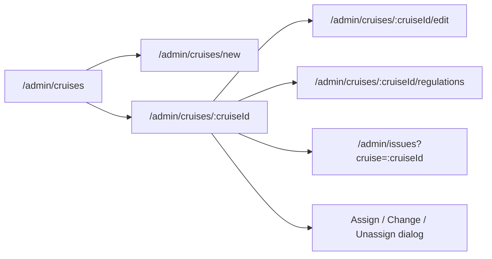

# WEB-CRUISE-001 — Cruise Management & Ship Assignment UI

Status: IMPLEMENTED AND VALIDATED (frontend mock)

Owner: Phan Văn Huy

Branch: `feat/WEB-CRUISE-001-cruise-management-ui`

Base commit: `77508ea0f6a577e3cf2505743f3fa116486f546c`

Pre-push sync: fast-forwarded to `origin/main` at `eb5313e` before commit; the incoming Ship/Deck/Cabin API and Vercel changes did not overlap this task.

App root: `CASMS_WebApp`

## Baseline worktree

Captured before edits: yes

Pre-existing untracked paths outside the app root:

- `.agents/`
- `skills-lock.json`

These paths belong to the user and must not be staged, reset, overwritten, or included in this task.

## Outcome

Deliver a frontend-only, API-ready mock implementation for Cruise Management and Ship Assignment.
The result must cover:

- Cruise List: search, status/type/departure-date/ship filters, reset, URL-backed pagination, and distinct loading/empty/no-results/error states.
- Cruise Form: create and edit with SQL-compatible fields and explicit `ONE_DAY` versus `MULTI_DAYS` schedule validation.
- Cruise Detail: cruise information, assigned ship, schedule, passenger-capacity summary, regulations, readiness, and cruise-linked operational issues.
- Ship Assignment: assign, change, and unassign with a precheck result and visible conflict/unavailability reasons.

The implementation is mock-only. It must model a future backend boundary without inventing persisted SQL fields or claiming that a client-side check is authoritative.

## Source priority and conflict rule

1. This task statement controls the required frontend behaviors.
2. `C:\Users\USER\Downloads\FOREP.sql` controls persisted entities, columns, enum values, nullability, and relationships.
3. Figma file `BKLkzpHzVteitEbRhx3oKg` controls visual hierarchy, component appearance, copy style, responsive behavior, and illustrated interaction states.
4. Repository architecture and engineering documents control module boundaries and quality gates.

When the sources disagree, do not silently merge their meanings. Keep the SQL model exact, adapt the Figma presentation around it, and record the mismatch in this contract. Static Figma values are sample content, not business invariants.

## Authoritative inputs

### Figma

File: `BKLkzpHzVteitEbRhx3oKg`, page `04 Admin Web` (`30:5`).

| Concern | Figma node | Use |
| --- | --- | --- |
| Desktop list | `105:2273` | Page hierarchy, metrics, table, existing search/status/ship filters |
| Desktop detail | `105:2412` | Cruise summary, information, itinerary, actions, assignment warning, regulations |
| Desktop edit | `105:2507` | Form hierarchy, disabled cruise code, assignment warning, save/cancel |
| Compact list | `105:3047` | 1024 px compact navigation and controlled horizontal table overflow |
| List states | `105:3147` | Loading, no-results/reset, error/retry semantics |
| Handoff rules | `105:3208` | Cruise/itinerary separation, overlap, readiness, open-for-sale, responsive rules |
| Ship detail | `96:1888` | Ship capacity and no-overlap warning |
| Ship handoff | `96:2636` | ACTIVE eligibility; capacity is not cabin availability; replacement precheck |
| Cruise regulations | `232:6962`, `233:6899` | Read-only inherited sources and existing cruise-regulation management route |

Final Cruise Management design section: `280:6128`.

| Final surface | Figma node |
| --- | --- |
| Complete list, all filters and pagination | `280:6129` |
| Create Cruise form | `280:6271` |
| Complete Edit Cruise form | `280:6350` |
| Complete Cruise Detail | `280:6429` |
| Ship Assignment dialog and candidate reasons | `280:6533` |
| Schedule/assignment/error state board | `280:6637` |
| Reusable Ship Candidate component | `282:334` |

### SQL

File: `C:\Users\USER\Downloads\FOREP.sql`.

- `Cruise_cruise_type`: `ONE_DAY`, `MULTI_DAYS` (lines 21–24).
- `Cruise_status`: `DRAFT`, `PUBLISHED`, `IN_PROGRESS`, `COMPLETED`, `CANCELLED` (lines 26–32).
- `Ship_status`: `ACTIVE`, `MAINTENANCE`, `INACTIVE` (lines 1–5).
- `Ship`: identity, status, `total_capacity`, and deck count (from line 472).
- `Cruise`: code/name, nullable `ship_id`, type, departure/return timestamps and ports, status (from line 510).
- `Port`, `Itinerary`, `ItineraryDay`, and `CruiseStop`: schedule/detail projection (from line 527).
- `OperationalRegulation`, `ShipRegulation`, and `CruiseRegulation`: regulation projection (from line 603).
- `OperationalIssue`: cruise-linked issue projection (from line 635).
- `Booking` and `BookingPassenger`: confirmed/active passenger count input (from line 697).
- `Cruise.ship_id` is nullable for a DRAFT cruise because assignment may occur after creation (comment near line 1380).

### Repository

- `AGENTS.md`
- `docs/engineering/architecture.md`
- `docs/engineering/development.md`
- `docs/engineering/git-workflow.md`
- `docs/design/screen-map.md`
- `docs/tasks/WEB-REG-001.md`
- `docs/tasks/WEB-OIM-001.md`

## Resolved Figma gaps and remaining backend constraints

The UI gaps found in the original WF-018 frames were resolved in the final WEB-CRUISE section above. Backend-only constraints remain explicit so the mock UI does not invent persistence or API rules.

| Gap | Current evidence | Required treatment |
| --- | --- | --- |
| Type/date filters and pagination | Required by task; absent from `105:2273` | Resolved in `280:6129` using existing Field/Button/Table components |
| Create form | Only edit frame `105:2507` existed | Resolved in `280:6271`; create defaults to `DRAFT` and code is editable |
| Cruise type | SQL uses `ONE_DAY/MULTI_DAYS`; old Figma showed `Round trip`, which belongs to `Itinerary.itinerary_type` | Resolved in `280:6271` and `280:6350`; Cruise Type is separate and SQL-compatible |
| Capacity/readiness/issues panels | Required by task; absent from `105:2412` | Resolved in `280:6429` with explicit source/unknown-state copy |
| Assign/change/unassign dialogs | Only warning copy existed | Resolved in `280:6533` and `280:6637`; reasons remain adapter-provided |
| Assignment history | No SQL assignment/history table | Do not invent or display assignment history |
| Readiness persistence | No `readiness` column/table in SQL | Treat readiness as a read-only aggregate/precheck response, never a persisted Cruise field |
| API endpoints | No confirmed Cruise API contract in the repository | Keep a typed mock adapter; do not hard-code speculative endpoint URLs |

## Scope

### In scope

- Routes:
  - `/admin/cruises`
  - `/admin/cruises/new`
  - `/admin/cruises/:cruiseId`
  - `/admin/cruises/:cruiseId/edit`
- Dialog/state ownership remains on the detail or form route; no assignment-only route is added.
- Existing routes are linked, not reimplemented:
  - `/admin/cruises/:cruiseId/regulations`
  - `/admin/issues?cruise=:cruiseId`
- Mock fixtures use only SQL-valid enum values and relationships.
- Query/filter/pagination state is URL-backed so refresh and direct links preserve context.
- A typed adapter maps SQL-shaped records to UI view models and aggregates.
- Admin desktop at 1440 px and compact desktop/tablet at 1024 px.

### Out of scope

- Live backend calls, endpoint invention, authentication, authorization, and server persistence.
- Itinerary CRUD, itinerary approval, open-for-sale actions, change requests, actual timing updates, or passenger-facing screens.
- Cruise lifecycle actions such as publish, cancel, start, or complete.
- Ship, deck, cabin, regulation, operational-issue, booking, or passenger CRUD.
- Assignment audit/history not represented by SQL.
- A client-side authoritative conflict/readiness engine.
- Mobile admin layouts below the existing Figma scope.
- New dependencies, a new design system, or unrelated refactors.

## Information architecture and routes



The Cruise feature may navigate to existing routes but must not import another feature. The application router composes public feature entries.

## Architecture

Create one feature module at `src/features/cruises` with this dependency direction:

```text
app/router.tsx
  -> features/cruises/index.ts
      -> pages
          -> components
              -> hooks
                  -> mock adapter
                      -> SQL-shaped records + DTO/view-model mappers
```

Recommended ownership:

```text
src/features/cruises/
  components/
    CruiseFilters.tsx
    CruiseTable.tsx
    CruisePagination.tsx
    CruiseListState.tsx
    CruiseForm.tsx
    CruiseSummary.tsx
    CruiseSchedule.tsx
    CruiseCapacity.tsx
    CruiseReadiness.tsx
    CruiseIssues.tsx
    ShipAssignmentDialog.tsx
    Cruises.module.css
  hooks/
    useCruiseList.ts
    useCruiseDetail.ts
    useCruiseForm.ts
    useShipAssignment.ts
  mocks/
    fixtures.ts
    mock-cruise-adapter.ts
  model/
    cruise-record.ts
    cruise-query.ts
    cruise-view.ts
    cruise-validation.ts
    ship-assignment.ts
  pages/
    CruiseListPage.tsx
    CruiseDetailPage.tsx
    CruiseFormPage.tsx
  index.ts
```

Use one `CruiseAdapter` interface/object for list, detail, create/update, readiness, and assignment operations. Do not introduce a global repository framework or duplicate the Ship/Regulation/OIM features inside Cruise.

## Data boundary

### Persisted record types

Persisted mock records must mirror SQL names/types semantically:

```ts
type CruiseType = 'ONE_DAY' | 'MULTI_DAYS'
type CruiseStatus = 'DRAFT' | 'PUBLISHED' | 'IN_PROGRESS' | 'COMPLETED' | 'CANCELLED'
type ShipStatus = 'ACTIVE' | 'MAINTENANCE' | 'INACTIVE'

type CruiseRecord = {
  cruiseId: string
  cruiseCode: string
  cruiseName: string
  shipId: string | null
  cruiseType: CruiseType
  departureDatetime: string
  returnDatetime: string
  departurePortId: string
  returnPortId: string
  status: CruiseStatus
  createdAt: string
  updatedAt: string
}
```

Resolved labels, itinerary summaries, capacity totals, readiness checks, issue counts, regulation sources, and conflict reasons belong in view models or adapter responses, not in `CruiseRecord`.

### Read models

- `CruiseListItem`: Cruise record plus resolved ship/port labels and itinerary summary.
- `CruiseDetailView`: Cruise record plus ship, schedule, capacity, regulation, readiness, and issue projections.
- `CapacitySummary`: `shipTotalCapacity`, active passenger count, remaining passenger headroom, and an explicit note that this is not cabin-category availability.
- `ReadinessResult`: `READY | BLOCKED | UNKNOWN`, ordered checks, and adapter-provided reasons.
- `ShipCandidate`: ship identity/status plus `AVAILABLE | UNAVAILABLE | REQUIRES_IMPACT_CHECK` and reasons.
- `AssignmentResult`: success/failure plus the authoritative returned assignment and conflict reasons.

No component may infer `READY` merely because visible fields look complete. Missing precheck data renders `UNKNOWN`, never success.

## Functional specification

### 1. Cruise List

Search:

- Case-insensitive search over cruise code and cruise name.
- Itinerary name may be included only through the adapter's resolved list projection.
- Debounce is optional; an explicit Apply action matching Figma is sufficient.

Filters:

- Status: exact `Cruise_status` values.
- Cruise type: exact `ONE_DAY` or `MULTI_DAYS`.
- Departure date: one calendar date; the adapter compares against the displayed departure timezone/date contract.
- Ship: exact ship ID, including an explicit “Chưa phân công” option for `ship_id IS NULL`.
- Any changed search/filter resets page to 1.
- Reset removes every filter while preserving the configured page size.

Pagination:

- Query keys: `q`, `status`, `type`, `departureDate`, `ship`, `page`, `pageSize`.
- Invalid enum/date/page values fall back safely.
- If filtering makes the current page invalid, replace it with page 1.
- Table counts and metrics come from adapter results; do not copy static Figma counts.

States:

- Loading is not rendered as zero records.
- Empty master data differs from no filter results.
- No-results preserves the active filters and offers reset.
- Error preserves query context and offers retry.
- 1024 px uses compact navigation and controlled horizontal overflow; text is not shrunk to force all columns on screen.

### 2. Cruise Create/Edit Form

Fields backed by `Cruise`:

- Cruise code: required, unique in mock adapter, editable on create and disabled on edit.
- Cruise name: required after trim.
- Cruise type: required `ONE_DAY | MULTI_DAYS`.
- Departure datetime and return datetime: required ISO-compatible values.
- Departure port and return port: required active Port IDs; the same port is allowed.
- Ship is managed through the assignment precheck flow, not silently overwritten by the general save request.
- New cruises are created as `DRAFT`; status/lifecycle controls are not added by this task.

Schedule validation:

- Always require `returnDatetime > departureDatetime`, matching the SQL check.
- `ONE_DAY`: departure and return must resolve to the same agreed calendar date, with return later than departure.
- `MULTI_DAYS`: return must resolve to a later calendar date than departure.
- Compare calendar dates in the agreed display timezone; do not compare by slicing raw UTC strings.
- Changing from `MULTI_DAYS` to `ONE_DAY` revalidates immediately and blocks save until the dates agree.
- Field errors are shown next to fields; the submit error summary focuses the first invalid control.
- The one-day/multi-day calendar rule is required by the task but is not encoded in SQL or the current Figma handoff; it must be confirmed with backend/product before live API integration.

### 3. Cruise Detail

Render these sections in Figma hierarchy:

1. Header summary: code/name, period, ship, duration, Cruise status, Itinerary status, and booking-data indicator as distinct concepts.
2. Information: SQL-backed Cruise fields and resolved ports.
3. Ship: current assignment, ship status/capacity, and Assign/Change/Unassign action capability.
4. Schedule: current itinerary, ordered days/stops, and clear separation of planned versus actual timestamps.
5. Capacity: passenger headroom versus `Ship.total_capacity`; never label it cabin availability.
6. Regulations: direct Cruise regulations plus inherited Ship/Global sources; link to the existing management route.
7. Readiness: adapter-provided checks for assignment/status/overlap, schedule/ports, itinerary approval, and capacity/feasibility. This is read-only in this task.
8. Issues: issues with matching `OperationalIssue.cruise_id`, summary by severity/status, and link to the existing filtered OIM list.

Unavailable aggregates show a transparent “Chưa có dữ liệu xác nhận” state. They must not be replaced with fabricated success values.

### 4. Ship Assignment

Actions:

- Assign: available when `ship_id` is null and the adapter capability allows it.
- Change: available when a ship is assigned and the adapter capability allows replacement.
- Unassign: available only when the adapter says it is allowed; the SQL comment confirms the intended null state for DRAFT, but FE does not generalize that into a server rule.

Precheck flow:

1. Open dialog and load candidates.
2. Selecting a ship requests a mock precheck.
3. Display status and every returned reason before enabling confirmation.
4. Confirm invokes adapter mutation; no optimistic assignment is shown before success.
5. On success, refresh detail/readiness/capacity projections and close the dialog.
6. On failure, keep selection/context and render retryable feedback.

Candidate/result rules:

- `MAINTENANCE` and `INACTIVE` ships remain visible when useful, but disabled with a reason.
- Overlap reasons include the conflicting cruise code and period supplied by the adapter.
- A replacement after booking/sale data exists is `REQUIRES_IMPACT_CHECK` or blocked according to adapter capability.
- Replacement checks may report capacity, cabin, facility, activity, or service dependencies, matching Figma handoff; FE does not calculate or silently resolve them.
- Network/unknown failure is not rendered as “Không có xung đột”.
- Cancel closes without mutation.

## Mock fixture matrix

Provide the smallest fixture set that exercises every required state while remaining SQL-valid:

| Fixture | Purpose |
| --- | --- |
| DRAFT + no ship + ONE_DAY | Create/detail unassigned state and successful Assign |
| DRAFT + ACTIVE ship + MULTI_DAYS | Change and successful Unassign |
| PUBLISHED + ACTIVE ship + booking data | Impact-check warning and restricted Unassign |
| IN_PROGRESS cruise | Detail state and assignment capability denial |
| COMPLETED/CANCELLED cruises | Status filters and read-only actions |
| ACTIVE candidate with overlapping cruise | Conflict reason |
| ACTIVE candidate with insufficient total capacity | Unavailability reason |
| MAINTENANCE and INACTIVE candidates | Status-based unavailability reasons |
| Cruise with linked regulations and operational issues | Detail integration projections |

All dates satisfy `return_datetime > departure_datetime`. All foreign keys point to existing mock records. Static fixture counts must not be presented as business constants.

## Accessibility and interaction requirements

- Every field has a programmatic label; validation uses `aria-describedby` and error text.
- Dialogs trap focus, have a named title, close on Cancel/Escape when safe, and restore focus to the trigger.
- Status/conflict meaning is conveyed by text/icon as well as color.
- Tables retain semantic headers and keyboard-accessible row actions.
- Loading and mutation feedback is announced through an appropriate live region.
- Disabled actions expose a visible reason; do not rely on a tooltip alone.

## Allowed changes for implementation

- `CASMS_WebApp/src/features/cruises/**` (new)
- `CASMS_WebApp/src/app/router.tsx`
- `CASMS_WebApp/src/shared/ui/AdminUI.tsx` (add Cruise navigation and optional Figma topbar slot)
- `CASMS_WebApp/src/shared/ui/AdminUI.module.css` (style the optional topbar without changing default consumers)
- `CASMS_WebApp/docs/tasks/WEB-CRUISE-001.md`
- `CASMS_WebApp/docs/design/screen-map.md`
- `CASMS_WebApp/docs/engineering/module-map.md`
- `CASMS_WebApp/tests/cruises/**` (focused domain and adapter behavior tests; no new test dependency)

No file deletion or rename is planned.

## Read-only dependencies

- `CASMS_WebApp/src/features/ship-deck-cabin/**`
- `CASMS_WebApp/src/features/regulations/**`
- `CASMS_WebApp/src/features/operational-issues/**`
- `CASMS_WebApp/src/styles/**`
- `C:\Users\USER\Downloads\FOREP.sql`
- Figma file `BKLkzpHzVteitEbRhx3oKg`

The new feature must not deep-import or directly import another feature. Shared identifiers are passed through routes or represented by local adapter DTOs until a confirmed domain module is justified.

## Ordered implementation plan

| # | Work item | Priority | Estimate | Depends on | Done when |
| --- | --- | --- | --- | --- | --- |
| 1 | Confirm/extend missing Figma states listed above | P0 | DONE | none | Final editable frames `280:6129`–`280:6637` and component `282:334` created and visually reviewed |
| 2 | Define SQL records, view models, query parser, form rules, and assignment capability types | P0 | DONE | 1 | SQL enums/null cases compile through typed record and view-model boundaries |
| 3 | Build SQL-valid fixtures and a deterministic mutable mock adapter | P0 | DONE | 2 | Success/conflict/unavailable/unknown cases are covered without synthetic persisted fields |
| 4 | Implement list route, filters, pagination, metrics, and list states | P0 | DONE | 2–3 | Direct URL/query interactions and 1440/1024 rendering verified |
| 5 | Implement create/edit form and schedule validation | P0 | DONE | 2–3 | ONE_DAY/MULTI_DAYS tests and browser validation/edit-lock checks pass |
| 6 | Implement detail information, ship, schedule, capacity, regulations, readiness, and issues | P0 | DONE | 2–3 | All eight sections render source-backed or transparent unavailable states |
| 7 | Implement assign/change/unassign dialogs and precheck/result states | P0 | DONE | 3, 6 | Browser smoke verifies reasons, successful assign, and successful unassign |
| 8 | Register public exports/routes and update module/screen maps | P0 | DONE | 4–7 | Four routes resolve directly and docs point to final Figma nodes |
| 9 | Visual/behavior QA and production checks | P0 | DONE | 4–8 | Focused tests, lint, typecheck, build, and rendered checks pass |

Estimated implementation effort: 4–5 focused developer days after the Figma composition gate is accepted.

## Agent execution instructions

An implementation agent must:

1. Read `AGENTS.md`, this contract, the architecture/development/git documents, and the referenced Figma/SQL sources before editing code.
2. Capture `git status --short` and the current base commit; preserve `.agents/` and `skills-lock.json` as user-owned baseline paths.
3. Work only on `feat/WEB-CRUISE-001-cruise-management-ui` or a later user-approved feature branch, never directly on `main`.
4. Follow the ordered plan. Do not skip the record/view-model boundary and retrofit it after components are written.
5. Use the existing admin visual language from the referenced Figma frames; do not introduce a replacement design system or dependency.
6. Stop and report the exact source conflict before inventing a persisted field, enum, endpoint, workflow, or cross-feature import.
7. Finish with the acceptance matrix, manual route/interaction evidence, repository checks, and a final baseline comparison before claiming completion.

This task-specific detail intentionally remains here rather than in global `AGENTS.md`; it is not a stable repository-wide rule.

## Acceptance criteria

### List

- [x] `/admin/cruises` renders directly and matches the approved 1440 px design hierarchy.
- [x] Search and all four filters work independently and together.
- [x] Filter/query state survives refresh and pagination.
- [x] Pagination boundaries, invalid query values, and page reset behavior are correct.
- [x] Loading, empty, no-results, and error/retry states remain distinct.
- [x] The 1024 px table uses controlled horizontal overflow per Figma.

### Form

- [x] Create and edit routes render directly.
- [x] SQL-required fields and enums are represented exactly.
- [x] Code is editable on create and immutable on edit.
- [x] `returnDatetime > departureDatetime` is enforced.
- [x] ONE_DAY same-date and MULTI_DAYS later-date rules are enforced in the agreed timezone.
- [x] Invalid forms cannot mutate the adapter; success returns to the expected route with refreshed data.

### Detail

- [x] All eight specified sections render.
- [x] Cruise and Itinerary states remain separate.
- [x] Capacity is not presented as cabin availability.
- [x] Readiness is adapter-provided and supports READY/BLOCKED/UNKNOWN.
- [x] Regulations distinguish direct/inherited sources and link to the existing regulation route.
- [x] Issues are filtered by cruise ID and link to `/admin/issues?cruise=:cruiseId`.
- [x] Missing related data uses explicit unavailable/empty states rather than invented values.

### Assignment

- [x] Assign, Change, and Unassign follow capability/precheck/mutation states.
- [x] Overlap, inactive/maintenance, capacity, dependency, impact-check, unknown, and success results are visibly distinct.
- [x] The UI never treats a failed/unknown precheck as available.
- [x] Cancel does not mutate state; mutation failure preserves dialog context for retry.
- [x] Successful assignment refreshes every dependent detail projection.

### Scope and quality

- [x] No feature-to-feature import is introduced.
- [x] No SQL-invalid enum, relationship, or persisted mock field is introduced.
- [x] No endpoint, assignment history, lifecycle action, or unrelated module is invented.
- [x] No dependency is added.
- [x] No change exists outside allowed paths.

## Manual QA matrix

1. Open each route directly and by in-app navigation.
2. Exercise each filter alone, combined, reset, refresh, and next/previous page.
3. Create valid ONE_DAY and MULTI_DAYS cruises; reject cross-day ONE_DAY, same-day MULTI_DAYS, equal timestamps, reversed timestamps, duplicate code, and missing ports.
4. Edit a cruise and confirm code immutability plus date/type revalidation.
5. Open each detail fixture and verify the source of every displayed field.
6. Assign an available ship, reject an overlapping ship, reject maintenance/inactive candidates, change to an eligible ship, exercise impact-check denial, and unassign only when allowed.
7. Verify linked Regulation and OIM routes preserve the cruise ID.
8. Check 1440 px and 1024 px against Figma; verify focus, keyboard, dialog, error, and retry behavior.

## Validation commands

Run from `CASMS_WebApp`:

```powershell
node --test tests/cruises/cruise-domain.test.mjs
npm run lint
npm run typecheck
npm run build
```

The focused domain suite uses the Node test runner already bundled with the runtime, so no test dependency was added. `tests/cruises/browser-smoke.mjs` is a manual browser harness that requires the Vite dev server and a Chrome remote-debugging page.

## Completion evidence

Validated on 2026-10-13:

| Evidence | Result |
| --- | --- |
| Final Figma composition | Section `280:6128`; frames `280:6129`, `280:6271`, `280:6350`, `280:6429`, `280:6533`, `280:6637`; reusable component `282:334` |
| 1440 px rendered QA | List, create, and detail visually reviewed against the final Figma hierarchy |
| 1024 px rendered QA | List reviewed with compact layout and controlled horizontal table overflow |
| Domain/adapter tests | 4 passed: schedule rules, URL query boundary, assignment precheck/mutations, combined filtering/create invariants |
| Browser smoke | Passed: URL filters, conflict dialog, invalid create schedule, edit-code lock, assign and unassign |
| `npm run lint` | Passed, zero warnings |
| `npm run typecheck` | Passed |
| `npm run build` | Passed after syncing latest `origin/main`; 181 modules transformed |
| Scope audit | Only documented Cruise/shared/router/docs/test paths changed; `.agents/` and `skills-lock.json` remain untouched |

`npx ai-devkit@latest lint` still reports the repository-wide absence of `docs/ai/{requirements,design,planning,implementation,testing}/README.md`. This task intentionally did not run `ai-devkit init` because the repository already uses its own canonical `docs/tasks`, `docs/design`, and `docs/engineering` structure, and adding a second documentation tree is outside WEB-CRUISE-001.

## Completion evidence required

- Baseline worktree rechecked and user-owned untracked paths preserved.
- Exact files added/modified/deleted/renamed by this task.
- Figma node IDs used for each implemented screen/state.
- Manual QA result for every row above at 1440 px and 1024 px.
- `lint`, `typecheck`, and `build` command results.
- Remaining Figma/source gaps and any unconfirmed backend rule.
- Screenshots are evidence of appearance only; they do not replace interaction QA.

## Scope expansion rule

If implementation needs a change outside the allowed paths, record the exact file, reason, impact, and source that requires it. Do not make the change until the task scope is explicitly expanded.
